# FULL A++ PROTOTYPE REPORT

**EEEN20020 Laboratory Report — Experiment 2: Audio Amplifier Design** (Deliverables 10–14)

**THIS IS A PROTOTYPE / EXEMPLAR — NOT A SUBMISSION.** It shows the standard, layout and reasoning of an exceptionally strong report, following the official template section by section.

- Every **[PROTOTYPE]** value, photo, screen and observation is **illustrative** and must be replaced with your own.
- Every **[SIM-REF]** value is a real **ngspice** result (not LTspice) and must be replaced with your own **LTspice** output.
- **[KEEP]** items are genuine pre-lab design work and stay once you have checked them.
- Boxes marked **GUIDANCE** explain how to earn the marks. **Delete them** from your real report.

## Cover page (template page 1)

| | |
|---|---|
| **UCD School of Electrical and Electronic Engineering** | **EEEN20020 Laboratory Report** |
| **Experiment 2 – Audio Amplifier Design** | |
| Name 1: | `‹STUDENT 1 FULL NAME — as on Brightspace›` |
| Student No. 1: | `‹8 digits, one per box›` |
| Name 2: | `‹STUDENT 2 FULL NAME›` |
| Student No. 2: | `‹8 digits, one per box›` |
| Declaration | *We have read and fully understood the consequences of plagiarism as discussed in the UCD Plagiarism and Academic Integrity Procedure - Student Guide. We fully understand the definition of plagiarism. We declare that the material in this submission is entirely our own work. We understand that it is necessary to wear eye protection in the laboratory.* (leave the wording unchanged) |
| Signed (Student 1): | `‹signature›` |
| Signed (Student 2): | `‹signature›` |
| Date | `‹DD› / ‹MM› / 2026` (the date of the lab session) |

**GUIDANCE (cover).**

- Use the official template file and do not alter the declaration text.
- Type each 8-digit student number one digit per box.
- Both students must sign. Insert a scanned or drawn signature image, or sign the printed page and scan it, whichever your module accepts.
- The cover page earns no marks, but an unsigned declaration can stop the report being marked at all.

## A  Amplifier design (pre-lab)  [5 marks]

**Nominal design parameters**  **[KEEP]**

| R1max | R2 | R3 | AVmin | AVmax |
|:---:|:---:|:---:|:---:|:---:|
| **50 kΩ** (trimmer, code 503) | **10 kΩ** | **10 kΩ** | **1.00 V/V** | **6.00 V/V** |

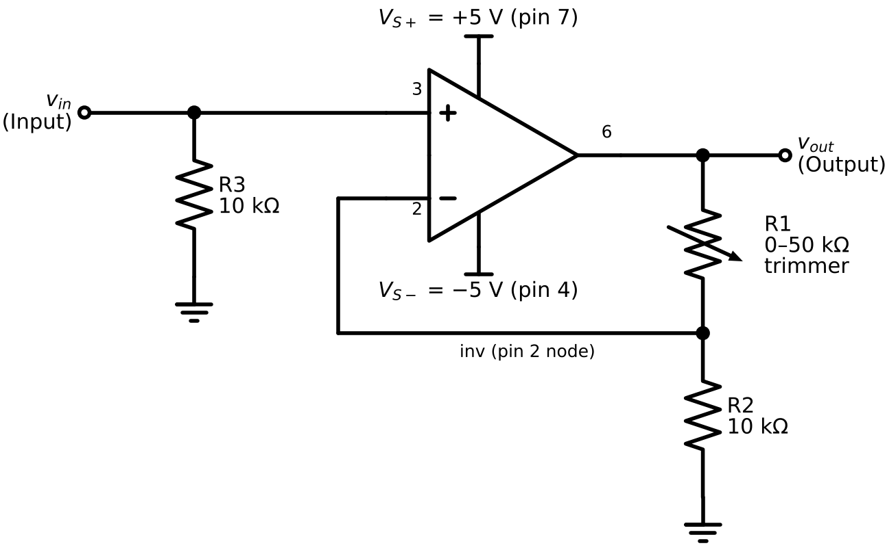

*Figure A1 – Variable-gain non-inverting amplifier (741, ±5 V supplies). R1 is a 50 kΩ trimmer wired as a rheostat (wiper and one end). Pin numbers refer to the 8-pin DIP.* **[KEEP]**

**Design calculation and justification**  **[KEEP]**

- **Gain.** For an ideal op amp (i₋ = 0, v₋ = v₊), R1 and R2 form an unloaded divider, so v_in = v_out · R2/(R1 + R2). Therefore **AV = 1 + R1/R2**.
- **AVmin.** With the pot at 0 Ω: AVmin = 1 + 0/10 kΩ = **1.00 V/V** (a unity-gain buffer, independent of R2).
- **AVmax.** The requirement AVmax ≥ 5 means R2 ≤ R1max/4 = 12.5 kΩ. We chose R2 = 10 kΩ, so AVmax = 1 + 50/10 = **6.00 V/V (15.6 dB)**.
- **Tolerance margin.** R1max/R2 = 5 versus ≥ 4 required gives a 25 % margin. The worst case with a ±10 % trimmer and ±5 % resistor is AVmax = 1 + 45/10.5 = 5.29, still ≥ 5. By contrast, R2 = 12 kΩ would nominally give 5.17 but fails the specification for about 30 % of tolerance combinations.
- **Headroom.** At AVmax, a 1 V pk-pk input gives 6 V pk-pk (±3 V). That is inside the ≈ ±3.5–4 V swing of a 741 on ±5 V, so there is no clipping.
- **R3 = 10 kΩ.** It provides the DC return path for the ≈ 80 nA input bias current; without it the output saturates (Section B). It gives an input resistance (10 kΩ) far above the generator's 50 Ω. It also roughly matches R1‖R2 = 8.3 kΩ at maximum gain, so bias-current offsets almost cancel.
- **Practical choice.** Using the same 10 kΩ value for R2 and R3 means only one fixed value needs fetching.

**GUIDANCE (A, 5 marks).** The template only asks for the table; the marks are for **correct, consistent values with units**.

- The short justification above protects those marks: it shows that AVmax ≥ 5 by design, not by luck.
- Keep it to about 8 lines in the real report.
- Common losses: no units; AVmax < 5 (for example R2 = 12 kΩ with a 50 kΩ pot plus tolerance); R1max not matching a pot that exists (5, 10, 20 or 50 kΩ); AVmin stated as 0.

## B  Simulation of nominal design (pre-lab)  [10 marks]

**Simulation configuration**  **[KEEP]**

| Item | Setting |
|---|---|
| Simulator / model | LTspice; op amp = `uA741` macromodel (`.lib uA741.lib`, opamp2 symbol) |
| Supplies | VCC = +5 V (pin 7), VEE = −5 V (pin 4) |
| Input source | `Vsig = SINE(0 {Vpk} 1k)`: sine, 0 V offset, **1 kHz**; Vpk = 0.5 V → **1 V pk-pk** (also run at Vpk = 0.05 V → 100 mV pk-pk) |
| Components | R2 = R3 = 10 kΩ; **R1 = 1 mΩ** (pot at minimum, ≈ 0 Ω) or **R1 = 50 kΩ** (pot at maximum) |
| Analyses | `.tran 0 6m 0 1u` (max step 1 µs = 1000 points/cycle), `.options plotwinsize=0`; `.op` with Vsig = 0.5 V DC (input positive peak) |
| Gain extraction | `.meas TRAN Vin_pp PP V(in) FROM 2m TO 6m`, `.meas TRAN Vout_pp PP V(out) FROM 2m TO 6m`, `.meas TRAN AV PARAM Vout_pp/Vin_pp` |

**Template box — "SPICE schematics to simulate minimum and maximum voltage gain"**

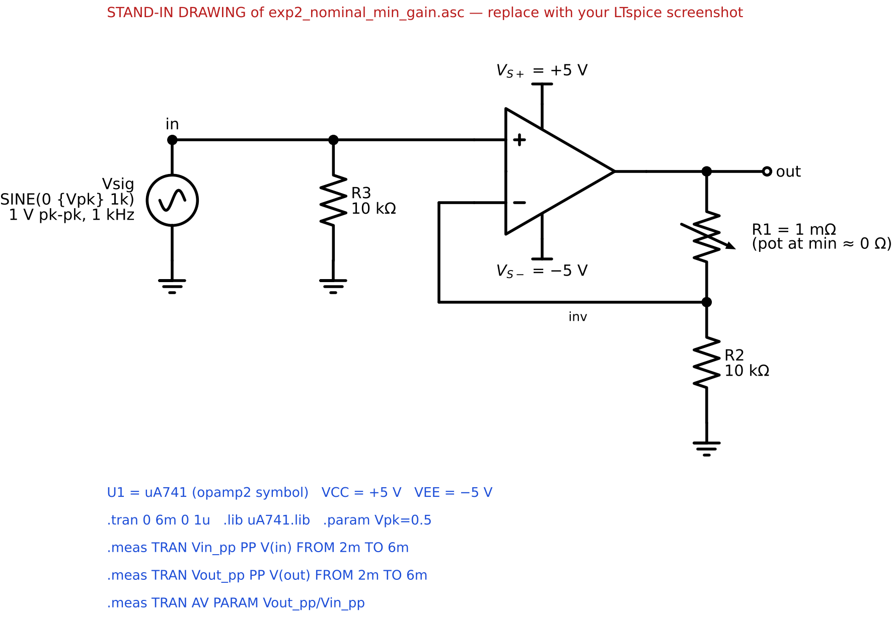

*Figure B1 – LTspice schematic for **minimum gain**: R1 = 1 mΩ (pot at 0 Ω), R2 = R3 = 10 kΩ, U1 = uA741, ±5 V, Vsig = 1 V pk-pk at 1 kHz.* **[PROTOTYPE stand-in drawing of `exp2_nominal_min_gain.asc` — replace with your LTspice screenshot]**

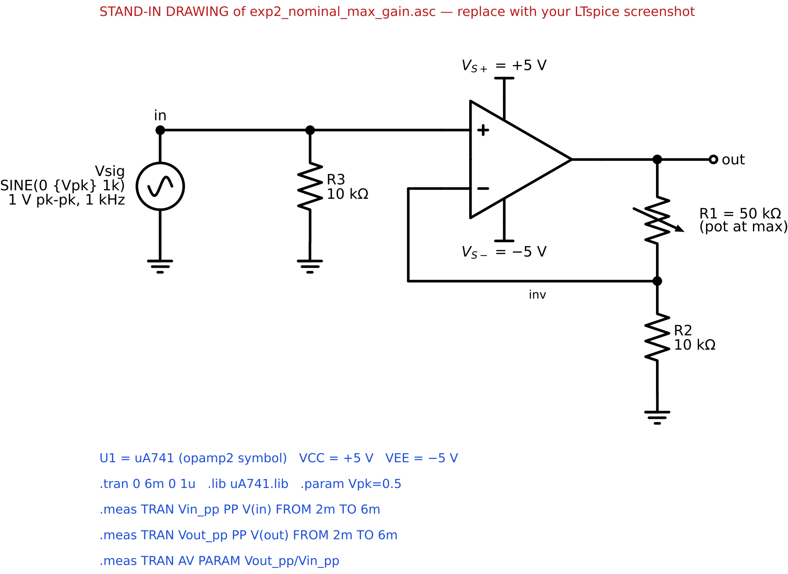

*Figure B2 – LTspice schematic for **maximum gain**: identical except R1 = R1max = 50 kΩ.* **[PROTOTYPE stand-in drawing of `exp2_nominal_max_gain.asc` — replace with your LTspice screenshot]**

**Template box — "SPICE output (node voltages and branch currents) for minimum and maximum gain configurations"**

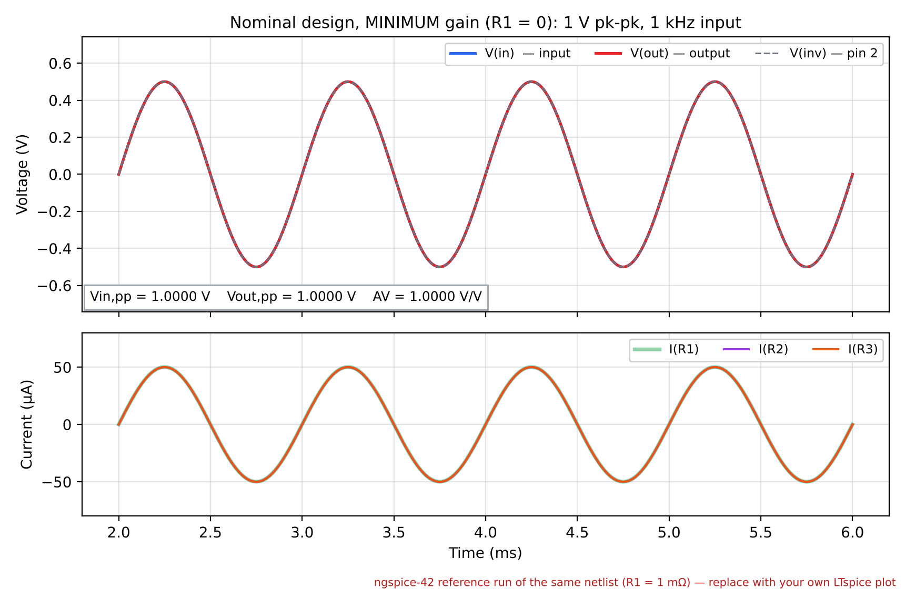

*Figure B3 – Minimum gain, 1 V pk-pk at 1 kHz. Top: V(in), V(out) and V(inv) coincide (unity gain, no phase shift). Bottom: branch currents I(R1) = I(R2) = I(R3) = 50 µA peak.* **[SIM-REF: ngspice 42 — replace with your LTspice plot]**

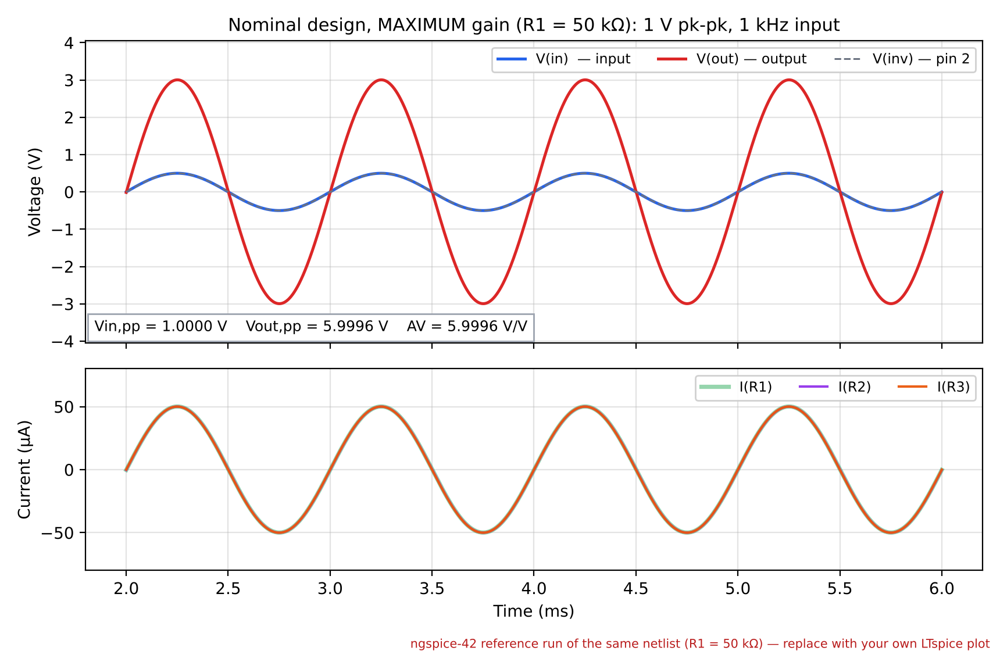

*Figure B4 – Maximum gain, 1 V pk-pk at 1 kHz. V(out) = 6.00 V pk-pk, in phase with V(in). V(inv) tracks V(in) (virtual short). All three branch currents are 50 µA peak, because R2 = R3 and (3.0 − 0.5) V/50 kΩ = 0.5 V/10 kΩ.* **[SIM-REF]**

**Table B1 – Node voltages and branch currents, `.op` at vin = +0.5 V (the positive peak of the 1 V pk-pk input)**  **[SIM-REF]**

| Configuration | V(in) [V] | V(inv) [V] | V(out) [V] | I(R1) [µA] | I(R2) [µA] | I(R3) [µA] | Iout(U1) [µA] | I(VCC) [mA] | I(VEE) [mA] |
|---|---:|---:|---:|---:|---:|---:|---:|---:|---:|
| Min gain (R1 = 0) | 0.5000 | 0.5000 | 0.5000 | 50.08 | 50.00 | 50.00 | 50.08 | −0.566 | +0.566 |
| Max gain (R1 = 50 kΩ) | 0.5000 | 0.4999 | 3.0039 | 50.08 | 50.00 | 50.00 | 50.08 | −0.566 | +0.566 |

The `.meas` values at the transient peak (t = 4.25 ms) agree with Table B1 to within 0.1 mV and 0.1 µA.

**What the SPICE output shows:**

1. **Virtual short confirmed.** V(inv) = V(in) to within 10 µV in both configurations, so the ideal-op-amp assumption used in Section A holds.
2. **The divider sets the gain.** At maximum gain, V(inv)/V(out) = 0.5/3.0 = R2/(R1 + R2) = 1/6.
3. **Bias current is visible.** By KCL at pin 2, I(R1) − I(R2) = 50.08 − 50.00 µA = **80 nA**, the 741's inverting-input bias current. It is real but only 0.16 % of the signal current.
4. **R3 is essential.** With the source disconnected, the non-inverting bias current flows through R3, giving V(in) = −80 nA × 10 kΩ = −0.80 mV (harmless). If R3 is removed, the input floats and the simulated output **saturates at −4.61 V**.
5. **DC offsets do not affect gain.** V(out) at maximum gain is 3.9 mV above 6 × 0.5 V; this is the offset IB·R1 ≈ 80 nA × 50 kΩ. It shifts the DC level by millivolts but does not change Vpp, so it does not affect the measured gain.
6. **Supply current.** I(VCC) = −0.566 mA means the +5 V source *delivers* 0.566 mA (SPICE sign convention: current into the + terminal).

| | AVmin | AVmax |
|---|:---:|:---:|
| **Voltage gain predicted by SPICE simulation (with nominal resistor values)** | **1.000 V/V** (0.99996) | **6.000 V/V** (5.9996) |
| *Supporting check: same at 100 mV pk-pk input* | *0.99996* | *5.9996* |

**[SIM-REF]**

The predicted gains are identical at 100 mV pk-pk and 1 V pk-pk, so the circuit is linear over this range. The residual −0.007 % from 6.000 comes from the 741's finite loop gain at 1 kHz: T ≈ (GBW/f)/AV ≈ 167, which gives a magnitude error of order 1/(2T²) plus AV/A0, and a phase lag of about 0.34°. For audio purposes the ideal design equation is exact.

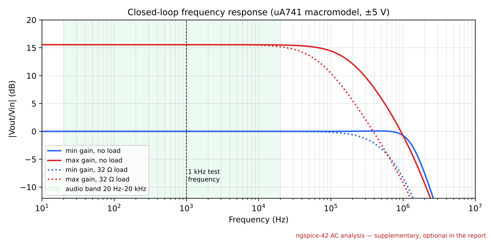

*Figure B5 (supplementary) – Closed-loop frequency response. The −3 dB bandwidth is 182 kHz at AVmax and 1.4 MHz at AVmin. The response is flat to 0.6 % across 20 Hz–20 kHz, so the 1 kHz gain applies to the whole audio band. A 32 Ω (headphone) load changes the 1 kHz gain by only 0.02 %.* **[SIM-REF]**

**GUIDANCE (B, 10 marks).** Marks come from four things:

1. **Two schematics**, readable, with values, source settings and directives visible.
2. **Waveforms** of input and output for both configurations, with axes and labels.
3. **Node voltages and branch currents** for both: the `.op` table screenshot or `.meas` log, or both.
4. **Correct predicted gains** in the table.

Interpretation like points 1–6 above is what lifts a correct section to an exceptional one. Use **your own LTspice screenshots**, never the stand-ins.

## E  Amplifier construction  [4 marks]

*(The template labels this section "E"; it corresponds to stage C of the lab sheet. Keep the template's label.)*

**Template box — "Insert a photo of your circuit layout on the breadboard"**

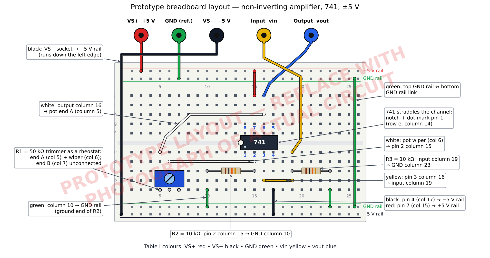

*Figure E1 – Breadboard realisation of the amplifier.*

- *The 741 straddles the centre channel, pin 1 at the notch/dot.*
- *R1 (50 kΩ trimmer, wiper and one end) connects the output column (pin 6) to the inverting-input column (pin 2).*
- *R2 = 10 kΩ runs from pin 2 to GND, and R3 = 10 kΩ from pin 3 (input) to GND.*
- *Supply rails: red +5 V, black −5 V, green GND. Signal leads: yellow vin, blue vout.*

**[PROTOTYPE LAYOUT — REPLACE WITH PHOTOGRAPH OF ACTUAL CIRCUIT]**

**Table I – Colour coding of signals** (from the lab sheet)  **[PROTOTYPE — record your actual colours]**

| Signal | VS+ | VS− | GND (Ref Node) | vin (Input) | vout (Output) |
|---|:---:|:---:|:---:|:---:|:---:|
| Colour | Red | Black | Green | Yellow | Blue |

**Supply verification before applying a signal** (optional extra; adds credibility)  **[PROTOTYPE]**

| Pin 7 (VS+) | Pin 4 (VS−) | Pin 6, no input (output DC offset) |
|:---:|:---:|:---:|
| +5.02 V | −5.01 V | +3 mV |

**GUIDANCE (E construction, 4 marks).**

- **Photo:** taken top-down, in focus, with the whole circuit and the 4 mm sockets in frame. Every component must be identifiable: label the 741, R1, R2 and R3 in the caption, or with small paper tags or arrows on the photo.
- **Wiring:** tidy, short wires, and the colour code followed.
- **Consistency:** the layout should visibly match Figure A1.
- **Common losses:** blurred photo; parts hidden under wires; the photo shows a different circuit from the one designed (for example a different pot).

## D  Amplifier measurements (sinusoidal test signal)  [18 marks]

**Template box — "Insert a photo of your measurement setup showing the breadboard, power supplies, signal source and oscilloscope."**

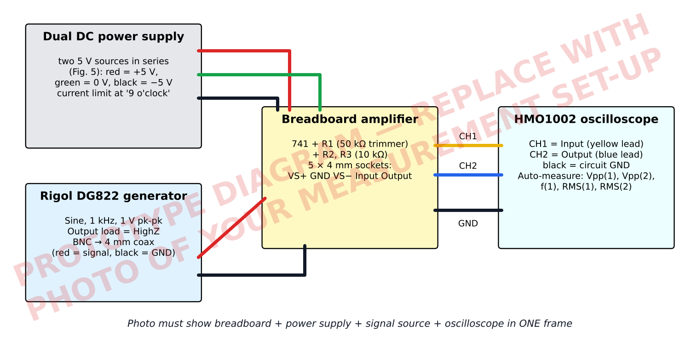

*Figure D1 – Measurement set-up.*

- *Dual DC supply: two 5.0 V sources in series giving ±5 V, current limit at 9 o'clock.*
- *Rigol DG822: sine, 1.000 kHz, 1.000 V pk-pk, 0 V offset, Load = HighZ. It feeds the amplifier input via the BNC–4 mm coaxial lead.*
- *R&S HMO1002 oscilloscope: CH1 = input, CH2 = output, common ground, DC coupling, 1× setting.*

**[PROTOTYPE DIAGRAM — REPLACE WITH PHOTO OF YOUR SET-UP]**

### Minimum gain configuration

**Template box — "Insert a photo of the oscilloscope screen showing the measured sinusoidal 'Input' and 'Output' signals with the signal generator as input and minimum gain."**

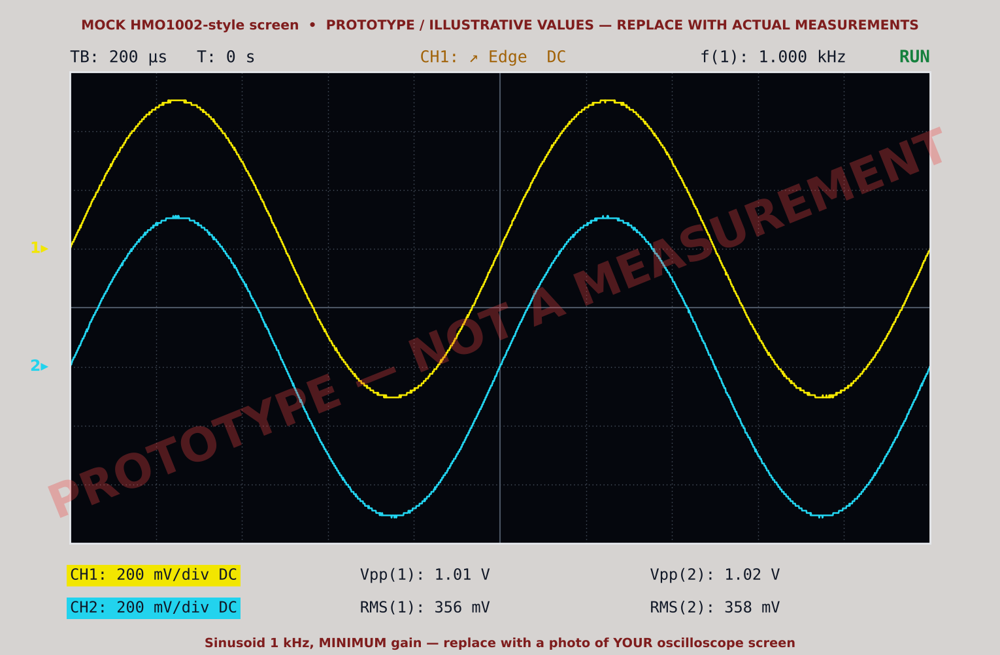

*Figure D2 – Minimum gain (pot at its 0 Ω end stop).*

- *CH1 (yellow) = input, CH2 (cyan) = output, both 200 mV/div. Traces are offset by ±1 div for clarity. Timebase 200 µs/div; trigger CH1 rising edge at 0 V.*
- *The output is an in-phase, equal-amplitude replica of the input.*
- *Readouts: Vpp(1) = 1.01 V, Vpp(2) = 1.02 V, RMS 356 mV / 358 mV, f = 1.000 kHz.*

**[PROTOTYPE MOCK SCREEN — replace with a photo of your oscilloscope]**

| Input (pk-pk) | Output (pk-pk) | Measured AVmin |
|:---:|:---:|:---:|
| **1.01 V** | **1.02 V** | **1.01 V/V** |

**[PROTOTYPE / ILLUSTRATIVE VALUES — REPLACE WITH ACTUAL MEASUREMENTS]**

**Working:** AVmin = Vout,pp/Vin,pp = 1.02 V / 1.01 V = 1.0099 ≈ **1.01 V/V** (3 s.f., matching the 3-s.f. readings).

**Interpretation:**

- The output is +1.0 % above unity, in phase and undistorted.
- About 0.35 % of this is the pot's end resistance (35 Ω measured in Section G: 1 + 35/9930 = 1.0035).
- The remainder (≈ 0.6 %) is within the channel-to-channel calibration and read-out resolution of the oscilloscope (Section F).
- The ≈ 0.06° phase lag predicted by SPICE is far too small to see.

### Maximum gain configuration

**Template box — "Insert a photo of the oscilloscope screen showing the measured sinusoidal 'Input' and 'Output' signals with the signal generator as input and maximum gain."**

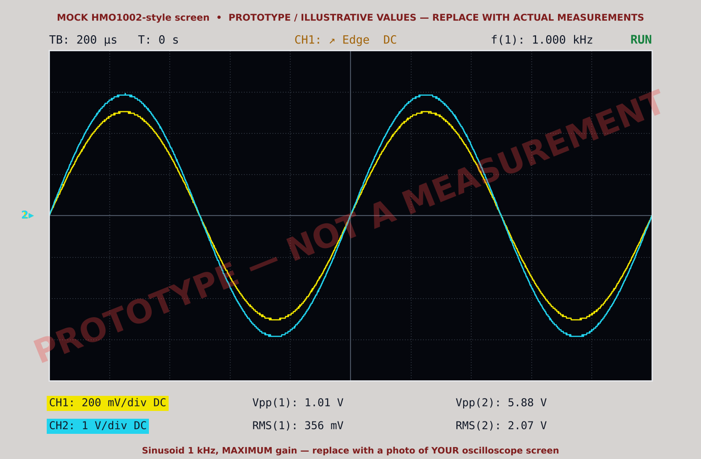

*Figure D3 – Maximum gain (pot at its 50 kΩ end stop).*

- *CH1 (yellow) = input at 200 mV/div; CH2 (cyan) = output at 1 V/div. Timebase 200 µs/div.*
- *The output is in phase with the input, with rounded peaks at about ±2.9 V, so there is no clipping.*
- *Readouts: Vpp(1) = 1.01 V, Vpp(2) = 5.88 V, RMS 356 mV / 2.07 V, f = 1.000 kHz.*

**[PROTOTYPE MOCK SCREEN — replace with a photo of your oscilloscope]**

| Input (pk-pk) | Output (pk-pk) | Measured AVmax |
|:---:|:---:|:---:|
| **1.01 V** | **5.88 V** | **5.82 V/V** |

**[PROTOTYPE / ILLUSTRATIVE VALUES — REPLACE WITH ACTUAL MEASUREMENTS]**

**Working:** AVmax = 5.88 V / 1.01 V = 5.822 ≈ **5.82 V/V**. RMS cross-check: 2.07 V / 356 mV = 5.81, within 0.2 %.

**Interpretation:**

- **Range verified.** The amplifier's gain is adjustable from **1.01 to 5.82 V/V**, which covers the required 1 V/V to ≥ 5 V/V with a 16 % margin above 5.
- **Agreement.** AVmax is 3.0 % below the 6.00 design value. Section F attributes this to component tolerance, and Section G confirms it.
- **No clipping.** The peaks (≈ ±2.9 V) stay inside the 741's ±5 V-supply headroom.

**GUIDANCE (D, 18 marks, the largest section).**

Each scope photo must show:

- **both** traces, each spanning ≥ 5 divisions and not clipped off-screen;
- legible **V/div** for both channels, **time/div**, and **Vpp(CH1), Vpp(CH2)** readouts (frequency too, ideally).

Each table must:

- give the **same numbers that are visible in the photo**, with **units**;
- give a gain equal to Output ÷ Input, to sensible significant figures (3 s.f.).

The set-up photo must show **all four**: breadboard, PSU, generator and scope.

The AVmax measured must be **≥ 5**. If yours is not, fix the circuit before moving on; do not just report it.

## E  Amplifier measurements (bench test signal)  [14 marks]

**How the bench test signal differs from the 1 kHz sinusoid.** It is a recorded speech/music-type signal:

- **broadband**, with energy from about 100 Hz to several kHz, rather than a single 1 kHz tone;
- **non-periodic and constantly changing**, so it cannot be triggered stably and Vpp depends on the moment captured;
- **an order of magnitude smaller** (≈ 150 mV pk-pk rather than 1 V);
- of **unknown source impedance**.

Each measurement is therefore a single acquisition frozen with RUN/STOP. Both channels are sampled at the same instants, so only the ratio *within one capture* is meaningful. The input Vpp legitimately differs between the minimum- and maximum-gain captures.

### Minimum gain configuration

**Template box — "Insert a photo of the oscilloscope screen showing the measured 'Input' and 'Output' signals with the bench test signal as input and minimum gain."**

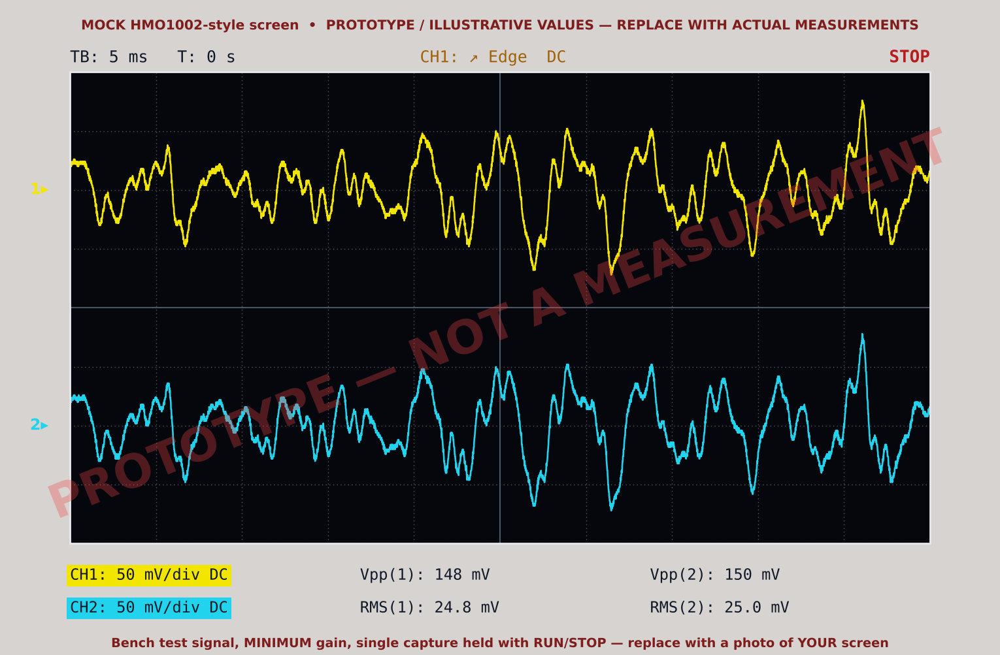

*Figure E2 – Bench test signal, minimum gain, single capture held with RUN/STOP.*

- *CH1 (input) and CH2 (output) both at 50 mV/div, offset ±2 div. Timebase 5 ms/div.*
- *The output reproduces every feature of the input at the same amplitude.*
- *Readouts: Vpp(1) = 148 mV, Vpp(2) = 150 mV; RMS 24.8 mV / 25.0 mV.*

**[PROTOTYPE MOCK SCREEN — replace with a photo of your oscilloscope]**

| Input (pk-pk) | Output (pk-pk) | Measured AVmin |
|:---:|:---:|:---:|
| **148 mV** | **150 mV** | **1.01 V/V** |

**[PROTOTYPE / ILLUSTRATIVE VALUES — REPLACE WITH ACTUAL MEASUREMENTS]**

**Working:** 150 mV / 148 mV = 1.014 ≈ **1.01 V/V**. RMS cross-check: 25.0/24.8 = 1.01.

**Interpretation:** this agrees with the sinusoidal AVmin (1.01). At unity gain the amplifier still gives power gain: its input draws negligible current, while its output can drive the low-impedance headphones.

### Maximum gain configuration

**Template box — "Insert a photo of the oscilloscope screen showing the measured 'Input' and 'Output' signals with the bench test signal as input and maximum gain."**

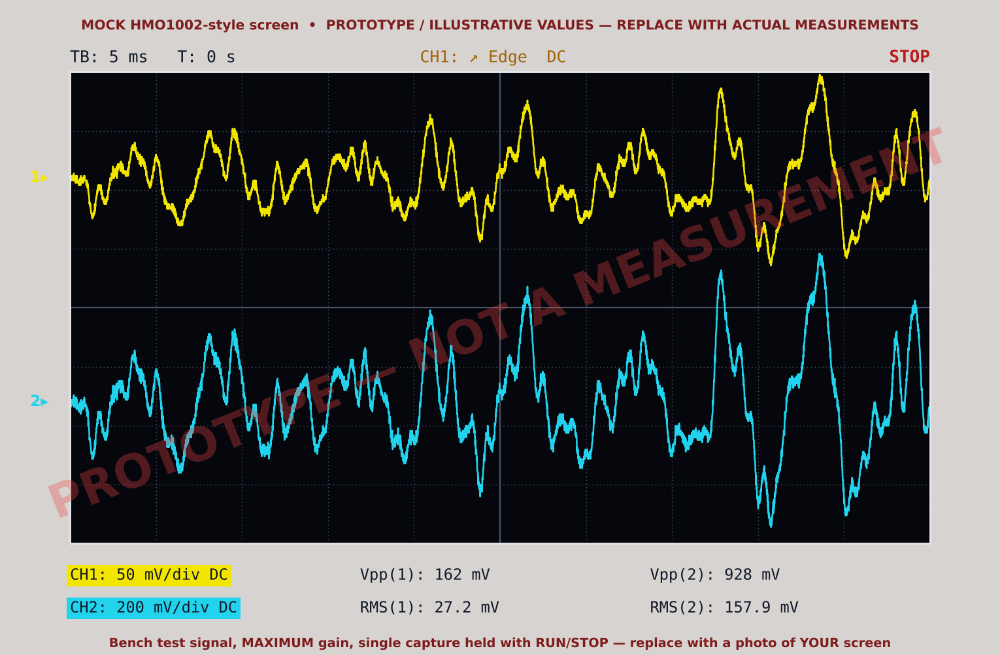

*Figure E3 – Bench test signal, maximum gain, single capture.*

- *CH1 (input) 50 mV/div; CH2 (output) 200 mV/div. Timebase 5 ms/div.*
- *The output is a scaled, undistorted copy of the input: no flattened peaks.*
- *Readouts: Vpp(1) = 162 mV, Vpp(2) = 928 mV; RMS 27.2 mV / 157.9 mV. Headphones connected.*

**[PROTOTYPE MOCK SCREEN — replace with a photo of your oscilloscope]**

| Input (pk-pk) | Output (pk-pk) | Measured AVmax |
|:---:|:---:|:---:|
| **162 mV** | **928 mV** | **5.73 V/V** |

**[PROTOTYPE / ILLUSTRATIVE VALUES — REPLACE WITH ACTUAL MEASUREMENTS]**

**Working:** 928 mV / 162 mV = 5.728 ≈ **5.73 V/V**. RMS cross-check: 157.9/27.2 = **5.81 V/V**.

**Interpretation:**

- The Vpp-based gain is 1.5 % below the sinusoidal AVmax (5.82), whereas the RMS-based gain agrees within 0.2 %.
- The amplifier is linear and flat across the audio band (Figure B5), so its gain for speech/music equals its 1 kHz gain.
- The small Vpp discrepancy is a property of the *estimator*. Vpp of a noisy, non-repetitive signal is set by two single extreme samples on each channel, and those are affected by noise and quantisation differently at 50 mV/div and 200 mV/div.
- RMS averages over thousands of samples, so it is the more reliable gain estimate for the bench signal.

**GUIDANCE (E bench, 14 marks).**

- Capture with **RUN/STOP** so that the photo, Vpp(1) and Vpp(2) all come from the **same frozen trace**.
- Make each trace large on screen, but with peaks not cut off.
- Use a timebase of about 2–5 ms/div: long timebases (50 ms/div) lower the sample rate and miss peaks.
- Recording the RMS values too costs nothing and gives you a powerful cross-check for the commentary.
- **Common losses:** gain computed from input and output captured at *different* times; trace clipped off the top of the screen; photo without readouts.

## F  Summary and commentary  [9 marks]

**Signal quality (Demonstrator to check)**

| | Yes | No |
|---|:---:|:---:|
| Is the signal audible and free of distortion? | **☒** | ☐ |

**[PROTOTYPE — HYPOTHETICAL OUTCOME. Only the Demonstrator's actual judgement may go here.]**

**Summary and commentary**

| | AVmin | AVmax |
|---|:---:|:---:|
| **Design** | 1.00 V/V **[KEEP]** | 6.00 V/V **[KEEP]** |
| **Simulation** | 1.000 V/V **[SIM-REF]** | 6.000 V/V (5.9996) **[SIM-REF]** |
| **Measurement** | 1.01 V/V **[PROTOTYPE]** | 5.82 V/V **[PROTOTYPE]** |

**Commentary (How closely do the designed, simulated and measured gains match? Explain any differences you have observed.)**  **[PROTOTYPE — rewrite around your own numbers]**

**1. Design vs simulation: agreement to 0.01 %.**

- The SPICE gains (0.99996 and 5.9996 V/V) match the design values (1.00 and 6.00 V/V) to within 0.007 %, even though the uA741 model includes finite open-loop gain, finite bandwidth, bias currents and output limits.
- At 1 kHz the 741's open-loop gain is about GBW/f ≈ 1000. This gives a loop gain of ≈ 167 at AVmax, and the closed-loop magnitude error is only of order 10⁻⁵, with a 0.34° phase lag.
- The gains are identical at 100 mV and 1 V pk-pk (linearity) and for supplies of ±4.75 V to ±5.25 V. The supply only sets the clipping limit, not the gain.
- The ideal relation AV = 1 + R1/R2 is therefore an accurate model at audio frequencies. Any real discrepancy must come from the components or the measurement, not the op-amp.

**2. Simulation vs measurement: +1.0 % (AVmin), −3.0 % (AVmax).**

The specification is met: 1.01 → 5.82 V/V. The deviations have identifiable physical causes, listed in order of size:

- **(a) Resistor and potentiometer tolerance (dominant, AVmax only).**
    - Since AV − 1 = R1/R2, ΔAV/AV = (AV−1)/AV · (ΔR1/R1 − ΔR2/R2) = 0.83 · (ΔR1/R1 − ΔR2/R2).
    - A ±10 % trimmer and ±5 % resistor allow up to ±12.5 %. The observed −3.0 % corresponds to the ratio R1max/R2 being 3.6 % low.
    - Section G confirms this: with the DMM-measured values (47.62 kΩ, 9.93 kΩ) the predicted AVmax is 5.80, within 0.4 % of the measurement.
    - AVmin is insensitive to tolerance (sensitivity factor 0 at AV = 1).
- **(b) Potentiometer end resistance (AVmin).**
    - At its end stop the trimmer does not reach 0 Ω. The measured 35 Ω gives AVmin = 1 + 35/9930 = 1.0035, which accounts for about a third of the +1.0 %.
    - Wiper contact resistance (a few Ω) in series with 50 kΩ is negligible at AVmax.
- **(c) Oscilloscope measurement uncertainty.**
    - Each channel has a DC gain accuracy of a few per cent (HMO1002 data sheet; ±2 % assumed here). Vpp is resolved to about 1/25 div (±0.8 % at 5 div), and random noise slightly inflates each Vpp reading.
    - In combination this gives about ±3 % (RSS) on a two-channel ratio, so AVmax = 5.82 ± 0.18 V/V.
    - Because the circuit's true AVmin is known to be 1.0035, the measured 1.0099 implies a CH2/CH1 calibration ratio of ≈ 1.006. Dividing AVmax by it gives 5.785, which agrees with the measured-component prediction (5.795) to 0.2 %, the resolution limit of the readings.
- **(d) Non-ideal 741 effects: negligible.**
    - Loop-gain error ≈ 0.002 %.
    - Slew rate: 0.5 V/µs available versus 0.019 V/µs required.
    - Output swing: ±2.9 V used of ≈ ±3.5–4 V available; the peaks were rounded, with no clipping.
    - Bias current and offset voltage shift the DC level by a few mV (SPICE: 4 mV) but cannot change Vpp.
- **(e) Loading: negligible for the gain.**
    - The generator's 50 Ω output resistance into R3 = 10 kΩ lowers vin by 0.5 % relative to the set amplitude (hence ≈ 1.00 V rather than exactly 1 V). The gain is computed from the *measured* input, so this cancels.
    - The scope's 1 MΩ ‖ 16 pF is negligible against a closed-loop output resistance below 1 Ω.
    - The headphones (≈ 32 Ω) reduce the 1 kHz gain by about 0.02 % (SPICE) while drawing ≈ 15 mA peak, safely below the 25 mA limit.
- **(f) Supply voltage: no effect on gain.** With the measured +5.02/−5.01 V, the gain is set by R1/R2 alone (PSRR ≈ 96 dB; SPICE gain unchanged for ±5 % supply variation).
- **(g) Breadboard and signal generator: not plausible causes.**
    - Contact resistances (mΩ) against 10 kΩ, and stray capacitances (pF) giving poles above ≈ 5 MHz, are many orders of magnitude too small to matter at 1 kHz.
    - The generator's amplitude and frequency accuracy do not enter a ratio of two *measured* voltages. The only way the generator could corrupt the result is clipping (50 Ω-mode doubling), and the measured 1.01 V input rules that out.

**3. Bench signal vs sinusoid.**

- The bench AVmin (1.01) matches the sine value. The bench AVmax is 5.73 by Vpp but 5.81 by RMS, within 0.2 % of the sine value.
- The amplifier gain is therefore the same for real audio. The Vpp shortfall comes from using single extreme samples of a non-repetitive signal.

**Conclusion.**

- Design, simulation and measurement agree within the combined component tolerance and measurement uncertainty.
- The dominant cause of the 3 % shortfall at maximum gain is component tolerance, and re-simulating with measured values (Section G) reduces the discrepancy to 0.4 %.
- Possible refinements:
    - 1 % resistors, or trimming the pot to a measured value;
    - averaged acquisitions;
    - a channel-swap calibration;
    - RMS-based gain estimates.

**Box-length version (≈ 170 words), if the template box is small:**

The design (1.00/6.00 V/V) and simulation (1.000/5.9996 V/V) agree to 0.01 %. At 1 kHz the 741's loop gain (≈ 167) makes the ideal relation AV = 1 + R1/R2 exact for practical purposes. The gains are unchanged at 100 mV/1 V input and for ±5 % supply variation.

The measured range of 1.01–5.82 V/V meets the specification. AVmax is 3.0 % low, consistent with resistor and pot tolerance: ΔAV/AV = 0.83(ΔR1/R1 − ΔR2/R2), up to ±12.5 %. Re-simulating with DMM-measured values predicts 5.80, within 0.4 %. AVmin is 1 % high because of the pot's 35 Ω end resistance (+0.35 %) and scope channel mismatch.

Scope accuracy (≈ ±3 % on a two-channel ratio) covers the residual. Finite op-amp gain, slew rate, offsets, supply voltage, loading and the breadboard each contribute < 0.1 % at 1 kHz.

The bench signal gives the same gain by RMS (5.81); its Vpp ratio (5.73) is less reliable for a non-repetitive signal.

**GUIDANCE (F, 9 marks).**

- **Table:** complete, with units, and with the same numbers as Sections A, B and D.
- **Commentary:** quantify every agreement as a percentage, and give a **mechanism** for each difference, with numbers showing it is the right size.
- Rule irrelevant effects in or out explicitly, and do not just list error sources.
- If you have measured values, use Section G to *prove* your explanation.

### Audio-quality analysis (model discussion)  **[PROTOTYPE — HYPOTHETICAL OUTCOME; replace with what you and the Demonstrator actually heard]**

- **Audibility.**
    - At AV = 1 the bench signal was audible but quiet (≈ 25–35 mV rms, of order 20–40 µW into 32 Ω headphones).
    - At AVmax it was clearly audible at a comfortable level. The Demonstrator judged it **audible and free of distortion**.
- **Why more voltage gain is louder.** The headphones have a fixed impedance, so the acoustic power is proportional to V².
    - Raising the gain from 1 to 5.82 increases the level by 20 log₁₀ 5.82 = **15.3 dB**, a 34× power increase.
    - Perceived loudness roughly doubles per 10 dB, so the maximum-gain setting sounded about **2.9× as loud**.
    - The amplifier cannot improve the source's signal-to-noise ratio: any hiss already in the bench signal is amplified by the same factor.
- **Absence of distortion, linked to the waveforms.** The CH2 trace (Figure E3) is a scaled copy of CH1, with no flattened peaks and no change of shape.
    - Clipping would add odd harmonics, heard as harshness or buzz. None was seen or heard.
    - SPICE shows the gain flat to within 0.6 % up to 20 kHz, so no part of the audio spectrum is emphasised or suppressed (no tonal coloration).
- **Limits set by the 741 and the ±5 V supplies.**
    - The output can swing only about ±3.5–4 V before clipping.
    - More importantly, the 741's output current is limited to about 25 mA. Into 32 Ω headphones that caps the undistorted peak at ≈ 0.8 V.
    - At maximum gain the bench signal peaks at about ±0.47 V (≈ 15 mA), a 40 % margin. Roughly 1.7× more gain or a louder source would cause current limiting on peaks and audible distortion.
    - The 741's slew rate (0.5 V/µs) and bandwidth (≈ 180 kHz at AV = 6) are more than adequate for these small audio-band signals.

## G  Optional (resimulation with *measured* component values)

**Nominal and measured parameters**  **[Nominal: KEEP · Measured: PROTOTYPE — hypothetical values, NOT measurements]**

| | R1max | R2 | R3 | AVmin | AVmax |
|---|:---:|:---:|:---:|:---:|:---:|
| **Nominal** | 50 kΩ | 10 kΩ | 10 kΩ | 1.00 | 6.00 |
| **Measured** | 47.62 kΩ (R1min = 35 Ω) | 9.93 kΩ | 9.97 kΩ | 1.0035* | 5.796* |

\* calculated from the measured resistances: 1 + R1/R2.

**Resimulation of design with *measured* parameter values**

**Template box — "SPICE schematics to simulate minimum and maximum voltage gain"**

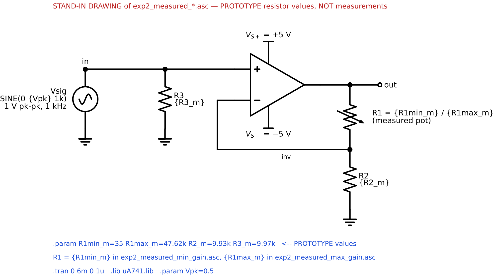

*Figure G1 – The same schematic with `.param R1min_m=35 R1max_m=47.62k R2_m=9.93k R3_m=9.97k`. R1 = {R1min_m} in the minimum-gain file and {R1max_m} in the maximum-gain file.* **[PROTOTYPE values · stand-in drawing of `exp2_measured_*.asc`]**

**Template box — "SPICE output (node voltages and branch currents) for minimum and maximum gain configurations"**

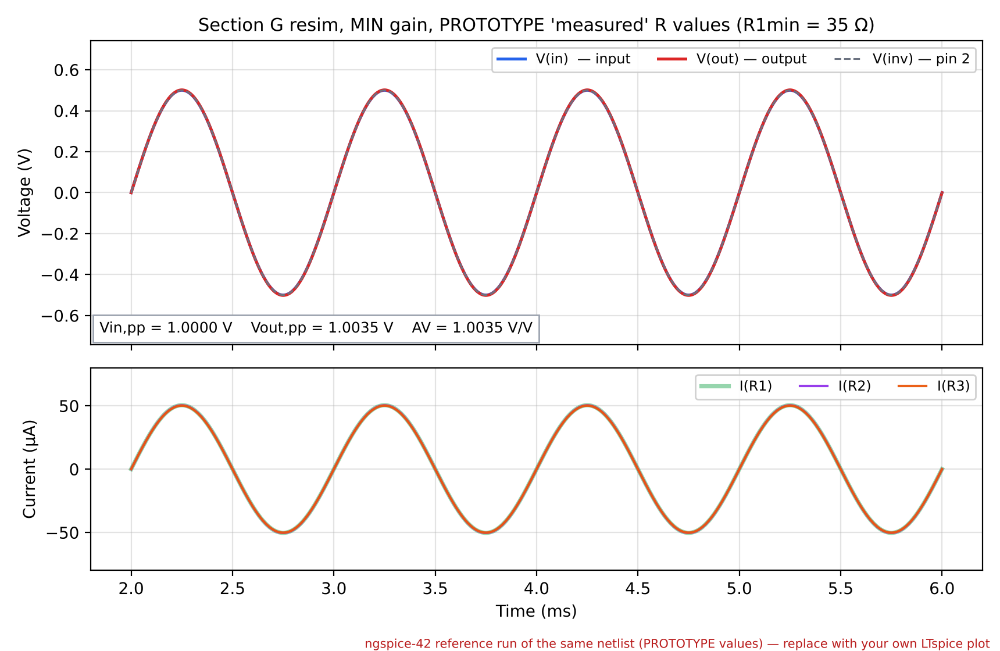

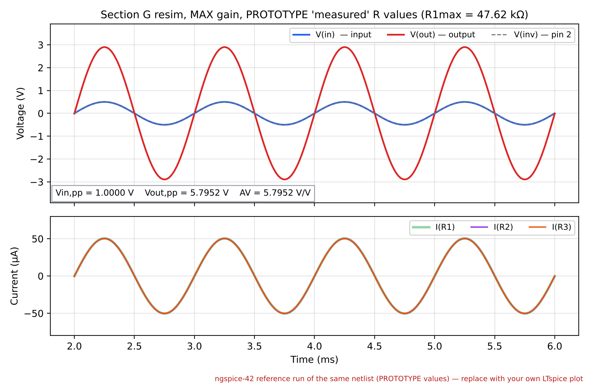

*Figures G2 and G3 – Re-simulation with the prototype "measured" values, 1 V pk-pk at 1 kHz.* **[SIM-REF run on PROTOTYPE values — redo with your own DMM readings in LTspice]**

| `.op`, vin = +0.5 V | V(in) [V] | V(inv) [V] | V(out) [V] | I(R1) [µA] | I(R2) [µA] | I(R3) [µA] |
|---|---:|---:|---:|---:|---:|---:|
| Min gain (R1 = 35 Ω) | 0.5000 | 0.5000 | 0.5018 | 50.43 | 50.35 | 50.15 |
| Max gain (R1 = 47.62 kΩ) | 0.5000 | 0.5000 | 2.9015 | 50.43 | 50.35 | 50.15 |

| | AVmin | AVmax |
|---|:---:|:---:|
| **Predicted by SPICE simulation (with measured resistor values)** | 1.0035 V/V | 5.795 V/V |
| **Measured values** | 1.01 V/V | 5.82 V/V |

**[PROTOTYPE]**

**Commentary (how closely do the simulated and measured results match when the measured component values are used? Explain any differences.)**  **[PROTOTYPE]**

- **Agreement improves sharply.** Using the measured resistances moves the predicted AVmax from 6.000 to 5.795 V/V. The discrepancy with the measurement (5.82 V/V) falls from **−3.0 % to +0.4 %**.
    - This confirms that component tolerance, mainly the trimmer being 4.8 % below its 50 kΩ nominal, was the cause of the shortfall.
    - The predicted AVmin rises to 1.0035 because of the pot's 35 Ω end resistance; the measured value is 1.01 (+0.6 %).
- **The residual is a measurement signature.** It has the same sign and nearly the same size at both settings (+0.6 % and +0.4 %), which is the signature of a gain-calibration mismatch between the two scope channels, not of the circuit.
    - The design is linear, so a channel-gain error scales both readings equally.
    - Dividing the measured AVmax by the inferred CH2/CH1 ratio (1.0099/1.0035 = 1.006) gives 5.785 V/V, within **0.2 %** of the re-simulation. That is at the read-out resolution of the oscilloscope.
- **No unexplained discrepancy remains.** The remaining non-idealities (op-amp loop gain ≈ 0.002 %, DMM accuracy ≈ 0.1 %, breadboard contacts ≈ 10⁻⁶) are below this level.
- **Conclusion:** with measured component values, simulation and measurement agree to within the measurement uncertainty.

**GUIDANCE (G, optional).**

- Measure every resistor and the pot (both extremes, wiper to the end you used) **out of circuit**. Record the values on the data sheet, ideally with a photo of the DMM.
- Edit the `.param` line in `exp2_measured_min_gain.asc` and `exp2_measured_max_gain.asc` and re-run.
- This section is unmarked, but it turns the F commentary from "probably tolerances" into proof. Do it if time allows: it takes about 10 minutes.

## Appendix P1 — Specification of each required oscilloscope figure (Deliverable 11)

| Figure | CH1 (input) | CH2 (output) | Timebase | Trigger | Expected readouts | Gain relation visible |
|---|---|---|---|---|---|---|
| D2 sine, min gain | 200 mV/div, +1 div offset, ≈ 5 div tall | 200 mV/div, −1 div offset, ≈ 5 div tall | 200 µs/div (2 cycles) | CH1 ↑ 0 V | Vpp(1) ≈ 1.0 V, Vpp(2) ≈ 1.0 V, f(1) = 1.000 kHz | Identical shape and height at the same V/div |
| D3 sine, max gain | 200 mV/div, 0 offset, ≈ 5 div | **1 V/div**, 0 offset, ≈ 6 div | 200 µs/div | CH1 ↑ 0 V | Vpp(1) ≈ 1.0 V, Vpp(2) ≈ 5.5–6.6 V | Same height on screen, but the V/div differs ×5. State this in the caption |
| E2 bench, min gain | 50 mV/div, +2 div | 50 mV/div, −2 div | 2–5 ms/div, **STOP** | CH1, normal | Vpp ≈ 0.1–0.2 V on both, RMS on both | Identical waveform detail on both traces |
| E3 bench, max gain | 50 mV/div, +2 div | 200 mV/div, −1.5 div | 2–5 ms/div, **STOP** | CH1, normal | Vpp(2) ≈ 5.5–6 × Vpp(1); RMS ratio ≈ AVmax | Same waveform, scaled; no flat tops |

**A submission-quality photo:**

- shot square-on, with no reflections or glare;
- shows the whole graticule plus the top and bottom readout bars;
- has legible text when the PDF is viewed at 100 %;
- has its caption beneath it, stating the configuration, the scales and the key readouts.

## Appendix P2 — Calculations and significant figures used in this prototype (Deliverable 12)

| Quantity | Formula | Prototype numbers | Result | Rule |
|---|---|---|---|---|
| AVmin (design) | 1 + 0/R2 | — | 1.00 | 3 s.f. |
| AVmax (design) | 1 + R1max/R2 | 1 + 50/10 | 6.00 | 3 s.f. |
| AVmin (sine) **[PROTOTYPE]** | Vout,pp/Vin,pp | 1.02/1.01 | 1.01 | same s.f. as the readings |
| AVmax (sine) **[PROTOTYPE]** | " | 5.88/1.01 | 5.82 | " |
| AVmin (bench) **[PROTOTYPE]** | " | 0.150/0.148 | 1.01 | " |
| AVmax (bench) **[PROTOTYPE]** | " | 0.928/0.162 | 5.73 | " |
| % difference (meas. vs design) | (meas − design)/design × 100 | (5.82 − 6.00)/6.00 | −3.0 % | 2 s.f. |
| % difference (meas. vs resim.) | (meas − resim)/resim × 100 | (5.82 − 5.795)/5.795 | +0.4 % | " |
| Gain in dB | 20 log₁₀ AV | 20 log₁₀ 5.82 | 15.3 dB | 3 s.f. |
| Ratio uncertainty | √(2 × 2² + 2 × 0.8²) % | ±2 % per channel, ±0.8 % read-out | ±3.0 % | assumed: quote your scope's data sheet |
